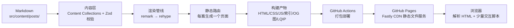

很多人对博客的心智模型是：它是一个「运行着」的网站，背后有一台时刻在线的服务器，等着响应每一位读者的请求。我这个博客从 2019 年到现在，从来没有一台为我运行的服务器——它是**纯静态站点**：所有页面在构建那一刻就变成了写死的 HTML 文件，线上没有 Node 进程、没有数据库、没有服务端逻辑。便宜、快、安全，代价是所有计算都必须前置到构建期。

这篇文章把「写下一篇 Markdown」到「读者看到页面」之间的完整过程拆开讲一遍，顺便回答一个反直觉的问题：一个「死」的文件树，为什么用起来像一个「活」的网站。

先给出全景图，后面每一节展开其中一个环节：

```text
写作阶段              构建阶段                          交付阶段
─────────────       ─────────────────────────       ─────────────────────
Markdown 文件   →    astro build（SSG 静态生成）  →   dist/ 纯静态文件
src/content/         类型检查 + 渲染管线 + 压缩         GitHub Pages CDN
250 余篇 .md         + 搜索索引 + OG 图 + LQIP          浏览器加载并渲染
```



---

## 一、内容层：一篇 Markdown 的「户口登记」

我写的每一篇文章，都是 `src/content/posts/` 目录下的一个 `.md` 或 `.mdx` 文件。但它们不是被「随手读进来」的——Astro 的 Content Collections 机制会给每篇文章做一次**入库登记**：

- `content.config.ts` 用 glob loader 声明集合：扫描 `src/content/posts/` 下所有 Markdown 文件；
- 每篇的 frontmatter 要过一道 **Zod schema 校验**：`title`、`published` 必填；`pin` 限定 0–99；`abbrlink` 只能是小写字母、数字和连字符。

这道校验的价值在于：**frontmatter 写错，构建直接失败**，而不是渲染出一个残缺的页面悄悄上线。比如日期写成了非法格式、pin 写成了 120，本地 `pnpm dev` 第一步的 `astro check` 就会拦下来。

有两个字段值得单独说：

- **`abbrlink`**：文章 URL 的「身份证号」。URL 规则是 `abbrlink || 文件名 id`——设了 abbrlink，以后随便改文件名，URL 都不变，对外链接（别人转载的、搜索引擎收录的）不会断。
- **`draft`**：草稿标记。路由生成时有这么一行过滤逻辑：`import.meta.env.DEV || !draft`——**草稿只在本地 dev 可见，生产构建自动剔除**。这意味着我可以把写到一半的文章直接提交进仓库存档，而不用担心它被发布。

「写」这一侧其实还有一圈工程保障把闭环串起来。`pnpm new-post <标题>` 一条命令脚手架出新文件，frontmatter 模板一次到位，还会防止覆盖同名旧文；截图和照片统一转成 WebP 放进 `public/assets/images/<年份>/<日期>/` 目录；写完跑 `pnpm format-posts`，用 autocorrect 批量修正中英文之间的空格和标点——这个脚本有个讲究：会先把正文里所有链接 URL 掩码成占位符再格式化，因为修正器连 URL 里的中英边界都会插空格，一个锚点链接就这么被悄悄改坏。提交代码文件时 pre-commit 钩子再自动过一遍 ESLint。

本地预览有两条路，对应两个渲染模式：`pnpm dev` 是**按需渲染**——请求到哪个页面才渲染哪个页面，改完热更新，草稿可见；`pnpm build` 则是**全量展开**，把每一篇都变成静态 HTML。所以发布前的最后一步是 `pnpm preview`：把构建产物原样起一个本地服务器，看的才是「读者将来看到的」。确认无误，push 到 main，剩下的一切交给 CI。

---

## 二、渲染管线：Markdown 是怎么变成 HTML 的

这是整条链路里最核心的一段。Astro 底层用 unified 生态处理 Markdown，数据流是标准的两段式：先把文本解析成 Markdown AST（remark 阶段），再转成 HTML AST（rehype 阶段），最后序列化成 HTML 字符串。我的 `astro.config.ts` 里在两个阶段各挂了一串插件，每个插件做一件事：

| 阶段 | 插件 | 干什么 |
| --- | --- | --- |
| remark | remarkDirective | 解析 `:::` 指令语法，是后面三个自定义插件的地基 |
| remark | remarkTextDirectives | 行内指令 `:文字[内容]{.class}`，做行内强调 |
| remark | remarkMath | 识别 `$...$` / `$$...$$` 数学公式语法 |
| remark | remarkContainerDirectives | 自定义容器：`:::note/tip/warning[标题]` 提示框、折叠块、图廊 |
| remark | remarkLeafDirectives | 叶子指令：嵌入 YouTube 视频、GitHub 仓库卡片等 |
| remark | remarkReadingTime | 计算中文阅读时长，写回 frontmatter 供页面显示 |
| rehype | rehypeKatex | 把数学公式渲染成 KaTeX 的 HTML |
| rehype | rehypeMermaid | Mermaid 图表**构建期**预渲染成 SVG（`pre-mermaid` 策略） |
| rehype | rehypeSlug | 给每个标题生成稳定的 id |
| rehype | rehypeHeadingAnchor | 标题旁加锚点链接，配合目录跳转 |
| rehype | rehypeImageProcessor | 图片处理：懒加载、尺寸声明等 |
| rehype | rehypeExternalLinks | 外链自动加 `target=_blank` + `rel=noopener` |
| rehype | rehypeCodeCopyButton | 代码块右上角的复制按钮 |

也就是说，你在我博客文章里看到的提示框、数学公式、流程图、目录锚点、代码复制按钮，**全部是在构建时算好的静态 HTML**。浏览器拿到什么就渲染什么，不需要现场执行任何转换逻辑。

代码高亮是另一个「前置计算」的典型：Shiki 用 `github-light` / `github-dark` 双主题同时高亮，输出带 CSS 变量的 HTML——白天黑夜切换主题时只是换一组变量值，高亮结果零重算、零闪烁。

:::note[一个隐蔽的坑]
Astro 7 默认会折叠行内元素之间的空白，这对英文无碍，对中文排版是灾难——「中文**加粗**中文」里的间距会丢失。所以配置里显式保留了旧版的空白处理行为（`compressHTML: true` 的 legacy 模式），这类「升级默认值变了」的问题在 CJK 站点上是重灾区。
:::

---

## 三、路由：文件即 URL，构建时全量展开

`src/pages/` 下的文件结构直接映射成 URL：`index.astro` 是首页，`tags/[tag].astro` 是标签页，`search/index.astro` 是搜索页。文章页的关键在 `posts/[slug].astro` 的 `getStaticPaths()`：

1. 构建时取出**全部**文章；
2. 每篇 map 成 `{ params: { slug: abbrlink || id }, props: { post } }`；
3. Astro 据此为每篇生成一个独立页面——250 余篇文章就是 250 余个 HTML。

生成路径前还有一道**重复 slug 检查**：两篇文章的 `abbrlink || id` 撞车，构建直接抛错终止。因为静态站点没有运行时兜底，路径冲突必须在构建期暴露。

数据查询这一层也有讲究。首页、标签页、归档、RSS 都需要文章列表，而「阅读时长」这个元数据要完整渲染一遍 Markdown 才有——把 250 篇文章渲染四遍显然不可接受。所以查询函数全部做了 memoize 缓存，阅读时长再按文章 id 单独缓存一层，整次构建里每篇文章的元数据只算一次。

---

## 四、构建期还悄悄产出了什么

`pnpm build` 不只是「把 Markdown 变 HTML」，它实际是三段串联：`astro check && astro build && pnpm apply-lqip`。除页面本身外，构建还产出了这些配套设施：

- **CSS**：UnoCSS 原子化方案。构建时扫描所有模板，把实际用到的类生成成按需的 CSS，没有运行时、没有冗余。明暗主题靠 oklch 颜色变量切换，换主题只是换一组 CSS 自定义属性。
- **搜索索引**：Pagefind 在构建尾声扫描 `dist/` 里带 `data-pagefind-body` 标记的内容（就是每篇文章的正文），切分索引成静态分片。所以这个博客的全文搜索**同样没有后端**——搜索页只是 fetch 几个静态 JSON 分片，在浏览器里现场匹配。
- **OG 分享图**：一个独立端点用 canvaskit-wasm 加内置的思源黑体，为每篇文章「画」一张带标题、描述、logo 和边框的 PNG。分享到社交平台时的卡片图就是这么来的，依然是构建期产物。
- **SEO 头部装配**：每页的 `<head>` 同样在构建期生成——canonical 规范链接、og:title、og:image、twitter:card 这些 meta 标签随页面一起写死，和上面的 OG 图配成一套完整的社交分享卡片。
- **自托管字体**：站内的可变字体 woff2 全部随仓库部署、自己服务，不依赖 Google Fonts 之类的第三方——少一个外部依赖，加载和隐私都可控。
- **订阅源与 SEO 文件**：RSS / Atom 用 feed 包生成，外加 sitemap 和 robots.txt，全是普通静态文件。
- **LQIP 图片占位**：构建后再跑一个自有脚本，用 sharp 把每张图缩到 3×3 像素，取三个关键位置的颜色压成一个 32 位十六进制值，以 CSS 变量的形式写进 HTML 的 `` 标签上。图片加载完成前，读者看到的是这块占位色，而不是白屏闪一下。映射结果缓存在一个 JSON 里，老图直接命中，增量构建很快。
- **压缩**：astro-compress 最后统一压缩 HTML / CSS / JS。

:::tip[一个小缓存陷阱]
Astro 会把每篇的渲染结果缓存在 `.astro/data-store.json` 里跨构建复用。切换配置或升级版本后如果发现渲染输出「不对劲」，先删掉这个缓存目录重建，再开始排查——十有八九是缓存作祟而不是 bug。
:::

---

## 五、发布：dist/ 如何变成线上站点

构建产物躺在本地 `dist/` 里，接下来是 `.github/workflows/deploy.yml` 接管——**push 到 main 分支即发布**。这个工作流分两个 job，做了四件事：

**1. 打包上传**：`upload-pages-artifact` 把整个 `dist/` 打成一个 gzip 压缩的 tar 包，作为名为 `github-pages` 的 artifact 上传。此时线上还什么都没变，文件只是躺进了 GitHub 的暂存区。

**2. 认证发布**：`deploy-pages` 调用 Pages 的内部 API 完成发布。认证靠 OIDC 短令牌——workflow 声明 `id-token: write` 权限，换取一个只活几分钟的身份令牌，仓库里不存任何长期密钥，令牌泄露也不构成持续风险。

**3. 原子替换**：Pages 后端解包校验后，把整棵文件树同步进它的存储，**整体原子替换**。线上要么全是旧版、要么全是新版，不存在「发布到一半」的中间态。连续推多个 commit 时，靠 `concurrency` 组让多次部署串行执行，不会互相踩踏。

**4. 留痕**：每次发布在仓库的 Environments 页面留一条 deployment 记录，哪次 commit、几点上线、发布到哪个 URL，全部可查。

:::note[为什么有个空的 .nojekyll 文件]
GitHub Pages 老的「从分支部署」模式默认对内容跑 Jekyll 处理，而 Jekyll 会**丢弃所有下划线开头的文件**——我的打包产物在 `_astro/` 目录下，会整个消失。现在用 Actions 模式部署，Jekyll 本来就不跑；仓库里留一个空的 `.nojekyll` 是双保险，防止哪天有人把部署源改回分支模式，站点瞬间残废。
:::

---

## 六、访问：一次请求的完整生命周期

发布完成后，读者访问 `https://…/posts/some-post/` 时发生了什么？GitHub Pages 本身**没有任何「展示」逻辑**——它不渲染、不执行代码，就是一个挂在 CDN（Fastly，全球 anycast 就近接入）后面的静态文件服务器。一次请求的旅程是：

1. **DNS + 接入**：域名解析到 CDN 边缘节点，TLS 证书自动管理，强制 HTTPS，支持 HTTP/2 和 HTTP/3。
2. **边缘缓存**：CDN 先查自己的缓存，命中直接返回；未命中或过期才回源取文件。
3. **URL → 文件查找**：这是静态服务器的全部智慧，就三条规则——

| 请求路径 | 实际查找 | 例子 |
| --- | --- | --- |
| 精确匹配到文件 | 直接返回该文件 | `/robots.txt`、`/_astro/chunk.XXXX.js` |
| 路径以 `/` 结尾 | 该目录下的 `index.html` | `/posts/some-post/` → `dist/posts/some-post/index.html` |
| 都找不到 | 返回 `/404.html`，状态码 404 | 主题里的 404 页面就是为这条规则准备的 |

4. **响应头按扩展名定**：`.html` 是 `text/html; charset=utf-8`，`.webp` 是 `image/webp`，字体是 `font/woff2`；内容做 gzip 协商压缩；所有响应默认带 `Access-Control-Allow-Origin: *`，搜索索引的 fetch、字体的跨路径加载都因此畅通。

第二行规则解释了配置里 `trailingSlash: 'always'` 的意义：Astro 默认每篇产出「一个目录 + index.html」，链接统一带尾斜杠，和静态服务器的目录解析严丝合缝。配套还有两个自动 301：访问不带斜杠的目录路径会跳到带斜杠版本；直接访问 `/xxx/index.html` 会跳到 `/xxx/`——保证同一页面只有一个规范 URL，对 SEO 有利。

**缓存策略**值得单独说：Pages 对所有内容给的是 **10 分钟** TTL（`max-age=600`）加 ETag 协商。看起来很短，但和 Astro 的产物结构配合得很好——打包出来的资源文件名里带内容哈希（`chunk.Cj8x3w2F.js` 那串后缀就是），内容一变名字就变，等于天然的缓存失效机制，根本不需要长 TTL，也永远不需要手动「清缓存」；反过来，内容没变的资源每次构建同名同姓，所以整站原子替换后，边缘缓存里还没过期的旧页面引用的资源在新文件树里依然存在，不会出现「页面引用了一个已被删掉的文件」的断裂窗口。

:::warning[Pages 的能力边界]
它是纯文件货架：不能自定义响应头（加不了 CSP）、没有服务端重定向（没有 `_redirects` 这种机制，重定向只能靠页面内手段）、没有任何运行时。我以前给旧 Jekyll URL 做跳转，最后之所以干脆整个放弃，就是因为服务端重定向这条路在 Pages 上天生不通。配额方面：站点限 1GB、带宽软限每月 100GB（超了是警告不是断供），Actions 模式下构建消耗的是 Actions 时长，公共仓库免费。
:::

---

## 七、浏览器端：静态页面为什么是「活」的

到这里，读者拿到的还只是一份 HTML。让页面「活」起来的，是构建时埋进页面的一小撮客户端脚本，都收敛在几个小组件里：

- **目录（TOC）**：滚动时高亮当前章节；
- **图片放大 / 代码复制**：点击交互；
- **媒体嵌入**：`lite-youtube-embed` 懒加载，视频缩略图之前不拉真身；
- **预取（prefetch）**：视口内出现的链接提前预取，翻页近似瞬时——这是静态站体验上最接近「动态站」的一招；
- **过渡动画**：文章列表和详情页的标题上标了共享元素标记，页面跳转时有 View Transitions 过渡；
- **主题切换**：换一组 oklch CSS 变量，瞬时生效；
- **第三方脚本隔离**：配置里还挂着 Partytown，真要开 Google Analytics 这类统计时，脚本会被挪进 Web Worker 执行，不阻塞页面主线程（我目前没开统计，它属于「随取随用」的预备设施）。

除此之外，搜索是按需 fetch 静态索引分片，评论组件接的是 Giscus 这类第三方方案。整个站点的「动态」就这么多，首屏 HTML 里没有任何框架运行时，没有 React hydration。

---

## 收束：这套架构的本质是一次取舍

把全链路串成一句话：

> **Markdown 经 Zod 校验入库 → unified 管线渲染成 HTML → 每篇文章展开成目录 + index.html → tar 包经 Actions 原子部署到 Pages 的 CDN → 访客请求按「文件 → 目录 index.html → 404」三条规则取文件 → 浏览器渲染 HTML 并执行那一点交互脚本。**

这套设计的本质，是**把所有能前置的计算全部前置到构建期**：数学公式、流程图、代码高亮、搜索索引、分享图、阅读时长、图片占位色，统统在 `pnpm build` 的几分钟里算完。换来的是：线上零服务器成本、零攻击面（没有运行时就没有漏洞）、全球 CDN 的加载速度、以及一切故障都可以在本地复现的确定性。代价是「实时性」——评论要借第三方，统计要借第三方，任何「每个请求都不一样」的功能都做不了。

对一个人的文字博客来说，这笔账怎么算都是划算的。
